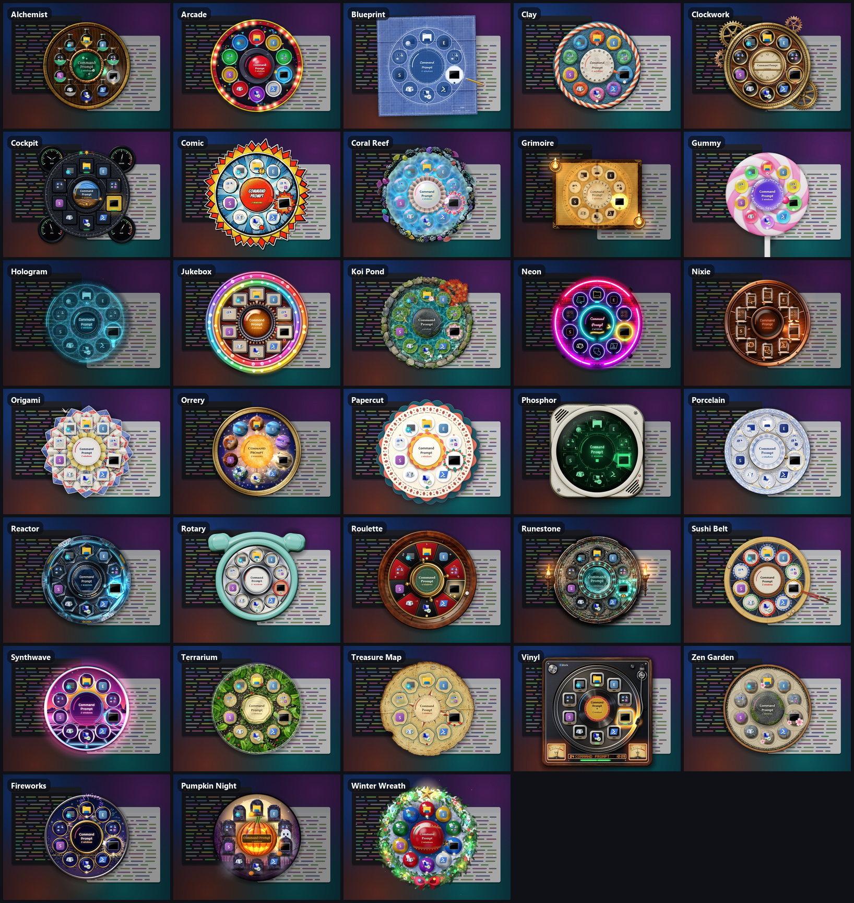
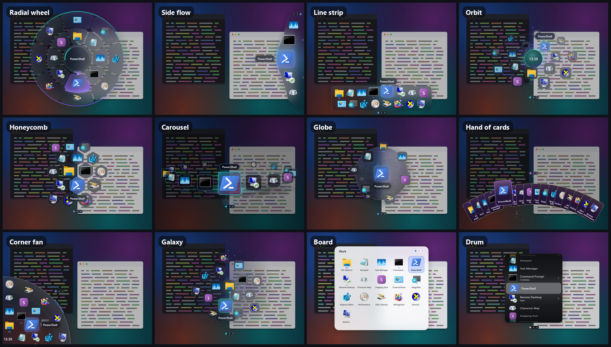
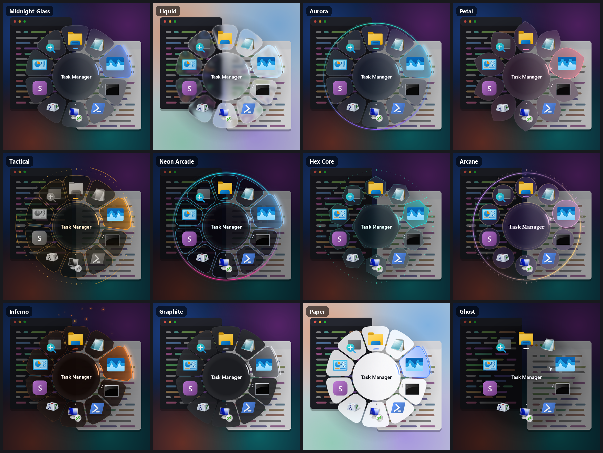
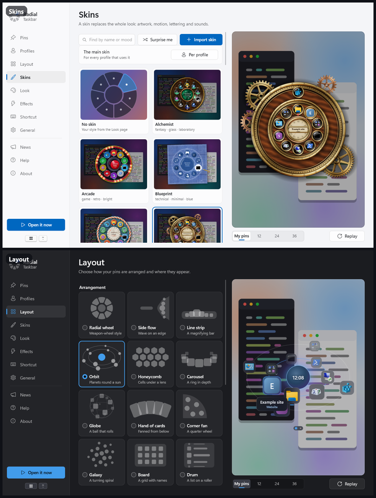

# Radial Taskbar

A light, native launcher for people who pin too many things. Press the shortcut and your pins appear as a weapon-wheel
style radial menu, or in one of eleven other arrangements. **Skins** replace the whole look, artwork, motion, lettering and
sounds included, and can be made, shared and imported. 76 come with it. [SKINS.md](SKINS.md) is all about them.

- One 2.5 MB program plus one file per skin. No runtime to install, no administrator rights.
- Measured: 5 to 10 MB of memory when idle, 30 to 60 MB while it is on screen, 0% CPU while idle. The first frame is on screen
  10 to 30 ms after the shortcut, with a skin as well.
- C++20, Direct2D + DirectComposition, so every animation runs on the GPU.
- It only goes online when you ask: for the logo of a website you add, or to look for an update.







## Install

Download `RadialTaskbar-Setup.exe` from the [Releases](../../releases) page and run it. It installs for the current user
only, can start with Windows, and adds an entry to Windows Settings > Apps. `Uninstall.exe` in the program folder removes
it as well.

On first start your taskbar pins are copied in. Nothing is removed from the real taskbar, and the two stay independent:
pinning or unpinning in one never changes the other.

An earlier Radial Taskbar, or the test version Radial Taskbar 2, is replaced: the setup removes it, and its pins, profiles,
looks and skins are taken over.

Updates: Settings > News > Check for updates. Your pins, profiles and settings stay.

## Use

| | |
|---|---|
| **Win + `** tap | Opens and stays open. Click an item, or press the shortcut again to close |
| **Win + `** hold, flick, release | Launches the item you flicked toward (weapon-wheel style) |
| A / D | Turn left / right |
| W / S | Reach out (group, outer ring, next page) / come back in |
| Space, F or Enter | Launch |
| 1 to 9 | Launch by number |
| Q / E, or mouse wheel | Previous / next profile, skipping locked ones (in page mode the mouse wheel turns pages, except over the profile ring). The direction can be reversed |
| Inner circle | One arc per profile: click one to switch. In hold mode rest on it for a moment and let go |
| Tab / Shift+Tab | Next / previous item |
| Shift + launch, or middle click | Open a new window even if the app is already running |
| Right click | Open as administrator, file location, unpin, profiles, settings |
| Esc, click outside, click the empty centre | Close |

Running apps are marked. Picking one switches to its window, and an app with several windows
extends outward so you can choose one. Groups extend the same way.

## Profiles

Every profile is a wheel of its own: work, games, a project. Switch with the mouse wheel, Q and E, or the arcs round the
centre.

- **Start on** one profile every time, or on the one you used last (Settings > Profiles).
- **Lock** a profile you only need now and then: the wheel and scrolling skip it until you unlock it. One always stays unlocked.
- **Skins and arrangements per profile**: each one uses the main skin, no skin, or one of its own, and the main arrangement
  or one of its own, say a wheel for work and a carousel for games (Settings > Profiles). Sizes and effects stay the same,
  and the centre keeps its size between profiles that share an arrangement.
- **Move or copy** an item to another profile from its right-click menu on the Pins page, or drag it onto the profile
  (hold Ctrl to copy).
- **Groups**: while a group is open on the Pins page, everything you add goes straight into it, and an app that is already
  pinned moves in with one click.

## Add things to the wheel

- **Right-click a taskbar button**: "Add to Radial Taskbar" appears right above the menu Windows opens, or "Remove from"
  when the app is already on the wheel. With several profiles, click the profile's name at the end of the row to choose
  another one. (Windows 11. Windows does not let other programs put entries inside that menu.)
- **Right-click a file, folder or shortcut** in Explorer or on the desktop > Show more options > Add to Radial Taskbar.
  Shift + right-click opens that menu directly. Send to > Radial Taskbar does the same.
- **The Pins page**: installed apps, files, folders, websites, groups, import from the taskbar.
- **Drop** files, or a link from a browser, onto the settings window.
- **The pin button** in the centre of the wheel pins the app you were just using.

Both right-click entries can be switched off under Settings > General.

## Pictures

A website gets its own logo and name when you add it. The program asks the site itself (and loads the picture from
wherever the site keeps it), never a logo service, and you can switch it off under Settings > General. Any item can have a picture of your own instead: choose a file (PNG, JPEG, WebP,
SVG, ICO ...), paste one with Ctrl+V (a copied picture or the address of one), or drop it on the open item, also straight
from a browser. "Auto" rounds full pictures, trims plain margins and puts a plate behind logos that would not be visible;
"As is", "Tile" and "Circle" choose for yourself. A copy is kept beside the settings, and a backup includes it.

## Layouts

| | |
|---|---|
| Radial wheel | the weapon wheel: rings, groups that extend, profiles round the centre. Also as three quarters, half or a third of a circle |
| Side flow, Line strip | on an edge, swelling under the pointer |
| Orbit | planets on tilted orbits round a sun that shows the time |
| Honeycomb | cells under a lens that follows the pointer |
| Carousel | a ring in depth; mouse wheel or A / D turn it |
| Globe | a ball; toward its rim it rolls, the mouse wheel spins it |
| Hand of cards | fanned from below, the focused card rises |
| Corner fan | a quarter wheel in a corner of the screen |
| Galaxy | a turning spiral, the first pins in its core |
| Board | a grid with names, in pages when there are many |
| Drum | a list on a roller, with names |

Every style and every skin works in all of them. Keys, groups, numbers, profiles (the dots) and the right-click menu are
the same everywhere.

## Settings

- **Pins**: profiles, drag to reorder, groups, websites, pictures, arguments, run as administrator, moving and copying between profiles, locks
- **Profiles**: the main skin and arrangement, a skin and an arrangement for every profile, the profile the wheel opens on, locks, scrolling direction
- **Layout**: twelve arrangements, centre of the screen or at the mouse pointer, item
  limit per ring and what happens past it (outer ring, unfold on reach, pages), sizes, profiles around the centre
- **Skins**: the gallery, importing, sharing and removing skins, hue / saturation / brightness, sounds
- **Look**: 12 styles (stylized, gamey, minimal) plus your own; slot shape, material, colours,
  opacity, blur, refraction, corners, borders, shadow, icon colour, font
- **Effects**: opening animation, speed, extension on focus, glow, 3D tilt, rim light, particles,
  HUD ticks, scan lines, radar pulse, launch burst, sounds, reduced motion; **background motion** over the darkened
  desktop (digital rain, stars, snow, fireflies, embers, bubbles, petals, bats; the skin's own or one for all)
- **Shortcut**: record any combination; free one-handed combinations are checked live on the PC
- **General**: startup, right-click entries, website logos, switching to open windows, pointer behaviour, backup
- **News**: updates and what changed. **Help**: how everything works, in English or Bulgarian. **About**: version and how to reach the author

Everything is stored in `%APPDATA%\RadialTaskbar\config.json`, with the previous version kept beside it as
`config.json.bak`. Export includes the shortcuts and pictures your pins use, so a backup survives a reinstall.



## Build

Needs MinGW-w64 GCC (WinLibs UCRT, 13 or newer), CMake and Ninja on PATH:

```powershell
.\build.ps1
```

The results land in `dist\`. Every folder below `skins\` is packed into a `.rskin` file on the way. Regression tests (the keyboard hook, the settings file against busy, damaged and lost
files, pictures and website logos, and skins: formulas, damaged archives and files):

```powershell
cmake -S . -B build -DRT_TESTS=ON; cmake --build build
$env:RADIALTASKBAR_DATA = "$env:TEMP\rt-test"; .\build\test_hook.exe; .\build\test_config.exe; .\build\test_picture.exe; .\build\test_skin.exe
```

`RADIALTASKBAR_DATA` points any copy of the program at a separate settings folder, and lets it run beside the
installed one. `RADIALTASKBAR_LOG` writes a log with opening and frame times.

## How it stays light

The resident process only holds the shortcut, the pins and their pictures. The settings window is a second process that
exits when you close it, and icons are extracted by a short-lived helper into a small cache, so no third-party shell
extension ever loads into the part that stays running. The same goes for website logos (nothing from the network is ever
handled by the resident part) and for the row beside a taskbar menu, whose helper leaves two minutes after its last use. Graphics memory is given back about 25 seconds after the last use. A
keyboard hook exists only while the shortcut is physically held (or if you choose to take over a shortcut Windows uses).

Skins are data, never code. Their pictures are loaded on worker threads, kept on disk in exactly the size they are drawn
(so the next opening takes no time) and leave memory with the rest of the graphics.

## Source map

| File | What it holds |
|---|---|
| `src/app.*` | Both processes: tray, single instance, saving, idle clean-up |
| `src/hotkey.*` | RegisterHotKey, and the hook that exists only while the shortcut is held |
| `src/overlay.*` | The transparent window: opening, input, launching, 3D tilt |
| `src/scene.*` | Shared drawing, frosted and liquid glass, particles. `Layout` is the interface a new arrangement implements |
| `src/radial.cpp`, `flow.cpp`, `strip.cpp` | The wheel, the side flow, the line strip |
| `src/arrange.cpp` | The nine other arrangements on one shared base |
| `src/looks.cpp` | Built-in styles |
| `src/skin.*` | What a skin can say: reading `skin.json`, finding, adding and packing skins |
| `src/expr.*`, `src/zip.*` | Formulas and archives, safe with files from strangers |
| `src/skinart.*` | A skin's pictures, fonts and sounds |
| `src/skinview.*` | Draws a skin: layers, lettering, particles |
| `src/bgload.*` | Reads and shrinks pictures in the background for the settings window |
| `src/live.*` | Clock, load and loudness for a skin's instruments |
| `src/icontone.cpp` | Icon treatments: engraved, neon, pixel, sticker ... |
| `src/config.*` | Every setting, JSON load and save |
| `src/shellutil.*` | Shortcuts, installed apps, launching, running windows |
| `src/icons.*` | Background icon loading |
| `src/picture.*` | Pictures people choose: decoding, tidying, keeping copies |
| `src/sitelogo.*` | A website's logo and name |
| `src/taskrow.*` | "Add to Radial Taskbar" beside a taskbar button's menu |
| `src/ui.*` | Immediate-mode controls used by Settings and Setup |
| `src/settings*.cpp` | Settings pages |
| `src/update.*` | Looking for a newer version, only when asked |
| `src/install.*`, `setup/` | Installer, uninstaller, and `Uninstall.exe` beside the program |
| `skins/`, `skins-extra/`, `tools/art/` | The bundled skins, those handed out as single files, and the scripts that draw them |
| `src/snapshot.*` | Headless rendering, for example `RadialTaskbar.exe --snapshot out.png --look tactical --items 14 --hover 3` |
